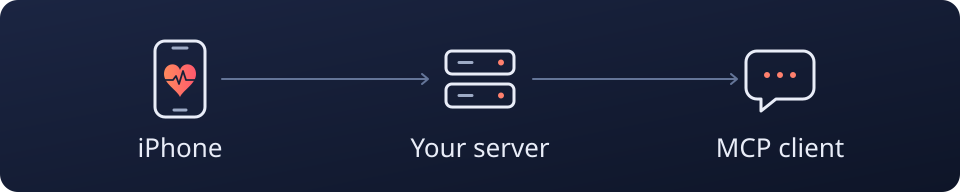
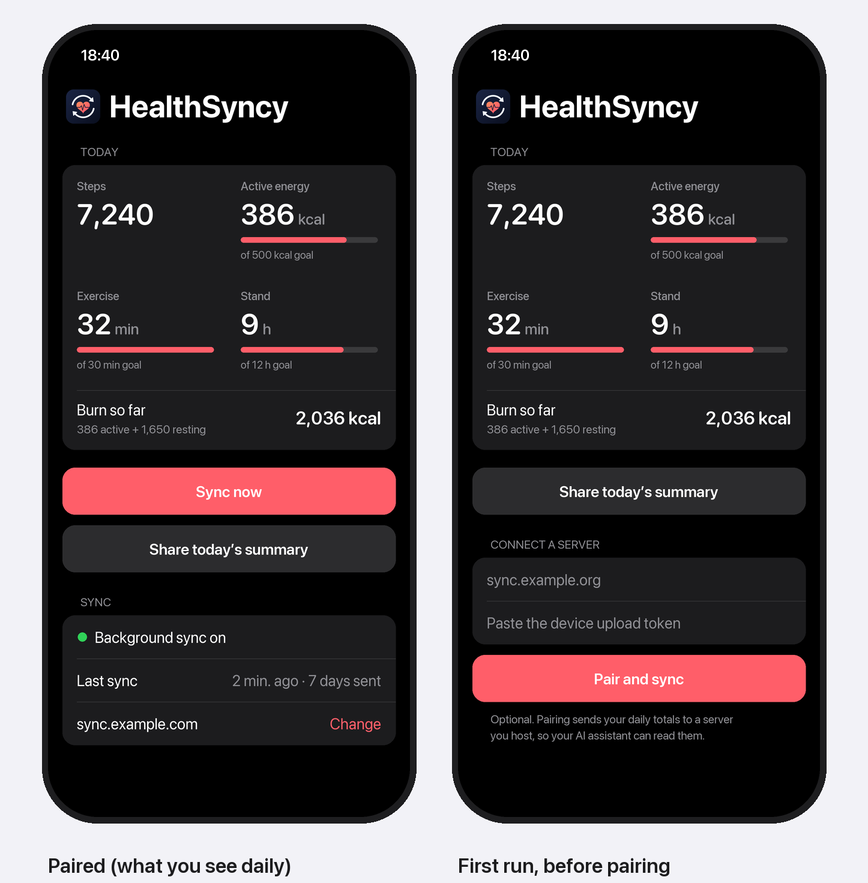

# HealthSyncy

**Share today’s Apple Health activity. Ask about your week.**

Copy your daily totals straight from your iPhone, or let ChatGPT read them through a Model Context Protocol (MCP) server you host. You choose which Apple Health categories to share.

With my food log in the chat, I can ask “How does today’s calorie intake compare with what I’ve burned so far?” HealthSyncy supplies my active and resting calories from Apple Health. I wrote about trading daily screenshots for that conversation in [AI, Meet Apple Health](https://mrrubin.substack.com/p/ai-meet-apple-health).

It’s C# end to end, from the iPhone app to the server. [Why C#?](#why-c)

## Share today’s activity



[Build and install the iPhone companion](docs/iphone.md) on a Mac. On your iPhone, open HealthSyncy and allow access to the categories you want. Tap **Share today’s summary**, then choose **Copy** or a destination in the iOS share sheet. This works before you set up a server.

Here’s a summary with example data.

```text
Apple Health · 2026-05-12 · 18:40 (America/New_York)
Steps: 7240
Active energy: 386 kcal
Resting energy: 1650 kcal
Burn so far: 2036 kcal
Exercise: 32 min
Stand: 9 h
```

## Ask about your week

“Which day did I walk the most this week?” With the server connected, ChatGPT can look up daily totals through the read-only MCP connector. Results include capture times so you can tell how recent they are. Each sync refreshes today and the previous six days. iOS controls when background updates run.

1. [Deploy the three services and MongoDB](docs/self-hosting.md). You’ll need a [K3s](https://docs.k3s.io/) cluster, public HTTPS and an OpenID Connect provider. Each instance serves one person.
2. [Pair your iPhone](docs/iphone.md#pair-with-your-server) and check the first upload against Apple Health.
3. [Connect ChatGPT via OAuth](docs/self-hosting.md#connect-chatgpt) with an account or workspace that supports custom MCP servers.

### For MCP clients

The connector exposes two read-only tools at `/mcp`. Dates are local calendar dates and each call takes an IANA time zone. The examples use New York time.

| Tool | Example arguments |
| --- | --- |
| `get_activity_day` | `{"day":"2026-05-12","timeZone":"America/New_York"}` |
| `get_activity_week` | `{"endingOn":"2026-05-12","timeZone":"America/New_York"}` |

A week spans seven days, including the end date. A day with no snapshot is unknown. Keep it distinct from a recorded zero.

## What gets shared

The companion can read steps, active and resting energy, exercise minutes, stand hours and ring goals where available. The server stores daily totals and timestamps. Raw samples and GPS routes stay out of the sync payload. An authorized client can read the synced totals, and any data returned to a chat is subject to that client’s settings.

## Why C#?

I chose C# because I love it. HealthSyncy is built with [C# 15] and [.NET 11], from [.NET for iOS] on the iPhone to [ASP.NET Core] on the server.

The iPhone app uses [UIKit] for its interface and [HealthKit] to read activity. On the server, [MongoDB] stores daily totals and the [MCP C# SDK] makes them available to authorized clients. For server sign-in, use [Keycloak] or another OpenID Connect provider.

[How the code is organised](docs/architecture.md#how-the-code-is-organised) shows where each pattern and language feature lives.

## Project guides

- [How HealthSyncy works](docs/architecture.md) covers the data flow, the code layout, API endpoints, missing days and time zones.
- [Privacy and operations](docs/self-hosting.md#privacy-and-operations) covers pausing uploads, revoking access and rotating the device token.
- [Contributing](CONTRIBUTING.md) explains how to build the .NET services, run the unit tests and run the integration suite with synthetic activity.
- [Security policy](SECURITY.md) explains how to report a vulnerability privately.

HealthSyncy is [MIT licensed](LICENSE). MongoDB Community Server uses the [SSPL](https://www.mongodb.com/legal/licensing/server-side-public-license).

[C# 15]: https://learn.microsoft.com/en-us/dotnet/csharp/whats-new/csharp-15
[.NET 11]: https://learn.microsoft.com/en-us/dotnet/core/whats-new/dotnet-11/overview
[.NET for iOS]: https://learn.microsoft.com/en-us/dotnet/ios/
[ASP.NET Core]: https://learn.microsoft.com/en-us/aspnet/core/overview?view=aspnetcore-11.0
[UIKit]: https://developer.apple.com/documentation/uikit
[HealthKit]: https://developer.apple.com/documentation/healthkit
[MongoDB]: https://www.mongodb.com/docs/manual/
[MCP C# SDK]: https://csharp.sdk.modelcontextprotocol.io/v2/
[Keycloak]: https://www.keycloak.org/securing-apps/oidc-layers
