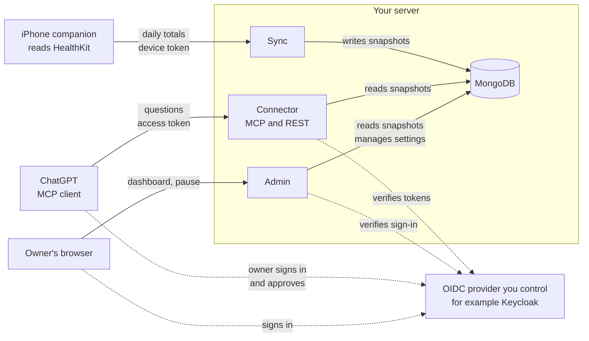

# How HealthSyncy works

The phone uploads to Sync. An authorized client reads through Connector. Admin uses a separate sign-in. Dotted arrows show where the identity provider handles sign-in and token verification.

| Component | Responsibility | Access |
| --- | --- | --- |
| iPhone companion | Asks for HealthKit read permission, calculates daily totals, sends snapshots to your sync host | Selected HealthKit types and a device upload token |
| Sync | Validates uploads and keeps the newest snapshot for each local date and time zone | Writes snapshots and reads the pause setting |
| Connector | Answers daily and seven-day queries through MCP and exposes a daily REST endpoint | Reads snapshots only |
| Admin | Displays activity, capture and receipt times, freshness alerts, and a seven-day history. Lets the owner pause uploads and set the alert threshold | Reads snapshots and manages settings |

## How the code is organised

The repository is also a C# case study, so the layout is deliberate. Each domain is a folder under `src` with up to three projects.

| Project | Holds | References |
| --- | --- | --- |
| `HealthSyncy.<Domain>.Contracts` | The records and enums that cross a boundary, such as request and response bodies | Other contracts only |
| `HealthSyncy.<Domain>.Domain` | The rules of the domain behind interfaces, and the `DI` registration that maps them | Its contracts and `Common` |
| `HealthSyncy.<Domain>.EntryPoint` | The host. A controller, MCP tool, page or app delegate checks its parameters, makes one call into the domain and maps the result | Its domain project |

| Domain | Entry point | Rules |
| --- | --- | --- |
| `Sync` | `DaysController` takes uploads from the phone | `IUploadService` decides whether an upload is saved, a duplicate, superseded, conflicting, rejected or paused |
| `Connector` | `ActivityController`, `MetadataController` and the MCP `ActivityTools` | `IActivityService` reads a day or a week |
| `Admin` | The Razor page `Pages/Index` | `IAdminService` builds the overview and saves settings |
| `Mobile` | `AppDelegate` on the iPhone | `ISyncService` and `ISummaryService` hold the rules. `ISyncServiceAgent` makes the HTTP call to Sync. The app implements `IHealthReader` with HealthKit and `IPairingRepository` with the keychain |
| `Common` | None | `Common.Contracts` holds the shared records. `Common.Infrastructure` holds the repository, the MongoDB health check and option validation |

`Common` is split in two so the phone can share the records without referencing MongoDB or ASP.NET Core.

Storage sits behind one generic interface, `IRepository<T>`, with one implementation, `MongoRepository<T>`. An entity names its collection through a static abstract member of `IEntity`, and the container maps the open generic once. Queries that belong to one entity, such as a week of snapshots, are extension members on `IRepository<SnapshotEntity>`. The rule for which snapshot wins stays in the Sync domain. `UploadService` hands the repository a condition, and the repository applies it in one atomic write.

### Patterns and language features

| Pattern or feature | Where to look |
| --- | --- |
| Interfaces and dependency injection | Each `DI` folder maps interfaces to implementations, and each `Program.cs` composes them |
| Generic repository | `Common.Infrastructure/Repository` |
| Result as a union type | `Sync.Domain/UploadOutcome.cs` and the exhaustive `switch` in `DaysController` |
| Records | Every `Contracts` project and the two entities |
| Extension members | The `DI` registrations, `SnapshotQueries` and `SettingsQueries` |
| Static abstract interface members | `IEntity.Collection` |
| Options validated at startup | `SyncOptions`, `ConnectorOptions`, `AdminOptions` and `MongoOptions` |
| Custom validation attribute | `HttpsUrlAttribute` |
| Custom authentication handler | `Sync.EntryPoint/Auth/UploadTokenHandler.cs` |
| Policy-based authorization | `ConnectorServiceRegistration` |
| Health checks | `MongoHealthCheck` behind `/readyz` |
| Pattern matching | `UploadService`, `AdminService` and `Pairing.Create` |
| `TimeProvider` for testable time | `UploadService`, `AdminService`, `SyncService` and `SummaryService` |
| Source-generated JSON | `Mobile.Domain/MobileJson.cs`, which keeps serialization safe under ahead-of-time compilation on iOS |
| Service agent for outbound HTTP | `Mobile.Domain/ServiceAgents` |
| Events | `ISyncService.Uploaded` |
| Coalescing concurrent work | `Mobile.Domain/Services/SyncQueue.cs` |

### Rules and tests

The code follows the rule set in `.editorconfig.ci` and `.globalconfig`, with Meziantou.Analyzer on every project. Warnings fail the build, a namespace matches its folder and each type has its own file. Test files are exempt from one rule, the unused-value check, because fluent assertion chains return a value.

Each domain has a unit-test project under `tests/unit`, written with xUnit, FluentAssertions and AutoMocker. The HTTP tests run each service in memory: Sync with its real token check, Connector with real token validation, and Admin through a full sign-in against a stub issuer. Pull requests fail below 90% line coverage. That figure covers the hand-written code in every project except the iPhone entry point, whose UIKit, HealthKit and keychain code runs only on a device. `checks/mongo.sh` covers what mocks cannot, which is concurrent writes and permissions against a real MongoDB.

## What gets synced

Steps, active and resting energy (kcal), exercise minutes, stand hours, and the three ring goals when available. The app uses Apple’s activity summaries for the rings and HealthKit statistics for steps and resting energy. For Move Time accounts it can return active energy from the quantity data and leaves the kcal goal empty. Stored snapshots include the local date, IANA time zone, capture time, and server receipt time.

HealthKit runs on the phone. The companion requests hourly background delivery for step and energy changes. iOS schedules the actual wakes, and the phone may be locked, offline or suspended. Opening the app or tapping **Sync now** also refreshes it. The admin status is evaluated when you load the page. Check the capture time when asking about today. [Apple’s background delivery guide](https://developer.apple.com/documentation/healthkit/executing-observer-queries).

Each refresh covers today and the preceding six days in the phone’s current time zone. The server retains earlier snapshots until the operator deletes them. Historical edits or outages outside that window need a separate backfill. A missing value is unknown. A measured zero is zero. A newer snapshot replaces a previous one and may contain lower totals or missing fields. When the entire day is unreadable, the client skips the upload and the previous capture time remains visible. Changing time zone can create a second set of daily buckets. Query the relevant zone and avoid adding overlapping buckets.

## Interfaces

| Interface | Calls |
| --- | --- |
| Phone upload | `PUT /api/v1/days/{yyyy-MM-dd}` on Sync with the device bearer token |
| REST read | `GET /api/v1/activity/{yyyy-MM-dd}?timeZone=America/New_York` on Connector with an owner access token |
| MCP | `get_activity_day(day, timeZone)` and `get_activity_week(endingOn, timeZone)` through `/mcp` |
| OAuth discovery | `/.well-known/oauth-protected-resource/mcp` on Connector |
| Operations | `/healthz` liveness and `/readyz` Mongo connectivity on each service |

An identical upload is safe to replay. An older capture is superseded. Conflicting values with the same millisecond timestamp receive HTTP 409. A paused service returns 423 for incoming uploads. An in-flight upload can complete while you pause. The device token has upload access only. Admin uses an owner-checked OIDC session and antiforgery protection. The connector validates the owner, issuer, audience, lifetime and requested scope before serving activity.
