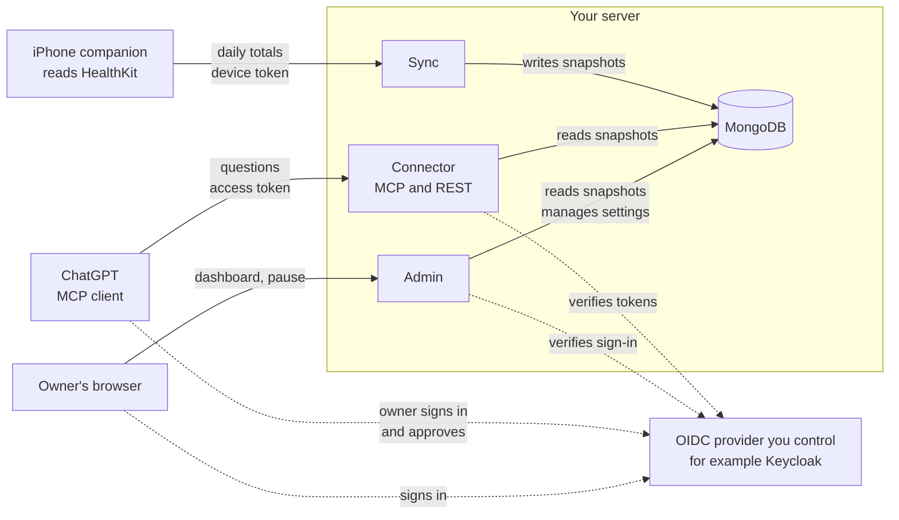

# How HealthSyncy works

The phone uploads to Sync. An authorized client reads through Connector. Admin uses a separate sign-in. Dotted arrows show where the identity provider handles sign-in and token verification.

| Component | Responsibility | Access |
| --- | --- | --- |
| iPhone companion | Asks for HealthKit read permission, calculates daily totals, sends snapshots to your sync host | Selected HealthKit types and a device upload token |
| Sync | Validates uploads and keeps the newest snapshot for each local date and time zone | Writes snapshots and reads the pause setting |
| Connector | Answers daily and seven-day queries through MCP and exposes a daily REST endpoint | Reads snapshots only |
| Admin | Displays activity, capture and receipt times, freshness alerts, and a seven-day history. Lets the owner pause uploads and set the alert threshold | Reads snapshots and manages settings |

The code has three layers:

| Layer | Location | Holds |
| --- | --- | --- |
| Entry points | `src/Services/HealthSyncy.*/HealthSyncy.*.EntryPoint` | Controllers, MCP tools and the admin page. Each one checks its parameters, calls the business logic and maps the result to a response |
| Business logic | `src/Libraries/HealthSyncy.BL` | The rules: which uploads are accepted, which snapshot wins, what a week is and when a snapshot is stale |
| Contracts and storage | `src/Libraries/HealthSyncy.Core` | The shared records and the MongoDB reads and writes |

Each layer depends on the interface of the one below it: entry points on `IActivityBL`, the business logic on `IActivityStore`. Both are registered through dependency injection. Entry points never call storage. The iOS project links the contract source and uses native HealthKit and UIKit bindings. Each service connects directly to MongoDB.

## What gets synced

Steps, active and resting energy (kcal), exercise minutes, stand hours, and the three ring goals when available. The app uses Apple’s activity summaries for the rings and HealthKit statistics for steps and resting energy. For Move Time accounts it can return active energy from the quantity data and leaves the kcal goal empty. Stored snapshots include the local date, IANA time zone, capture time, and server receipt time.

HealthKit runs on the phone. The companion requests hourly background delivery for step and energy changes. iOS schedules the actual wakes, and the phone may be locked, offline or suspended. Opening the app or tapping **Sync now** also refreshes it. The admin status is evaluated when you load the page. Check the capture time when asking about today. [Apple’s background delivery guide](https://developer.apple.com/documentation/healthkit/executing-observer-queries).

Each refresh covers today and the preceding six days in the phone’s current time zone. The server retains earlier snapshots until the operator deletes them. Historical edits or outages outside that window need a separate backfill. A missing value is unknown. A measured zero is zero. A newer snapshot replaces a previous one and may contain lower totals or missing fields. When the entire day is unreadable, the client skips the upload and the previous capture time remains visible. Changing time zone can create a second set of daily buckets. Query the relevant zone and avoid adding overlapping buckets.

## Interfaces

| Interface | Calls |
| --- | --- |
| Phone upload | `PUT /api/v1/days/{yyyy-MM-dd}` on Sync with the device bearer token |
| REST read | `GET /api/v1/activity/{yyyy-MM-dd}?timeZone=America/New_York` on Connector with an owner access token |
| MCP | `get_activity_day(day, timeZone)` and `get_activity_week(endingOn, timeZone)` through `/mcp` |
| OAuth discovery | `/.well-known/oauth-protected-resource/mcp` on Connector |
| Operations | `/healthz` liveness and `/readyz` Mongo connectivity on each service |

An identical upload is safe to replay. An older capture is superseded. Conflicting values with the same millisecond timestamp receive HTTP 409. A paused service returns 423 for incoming uploads. An in-flight upload can complete while you pause. The device token has upload access only. Admin uses an owner-checked OIDC session and antiforgery protection. The connector validates the owner, issuer, audience, lifetime and requested scope before serving activity.
